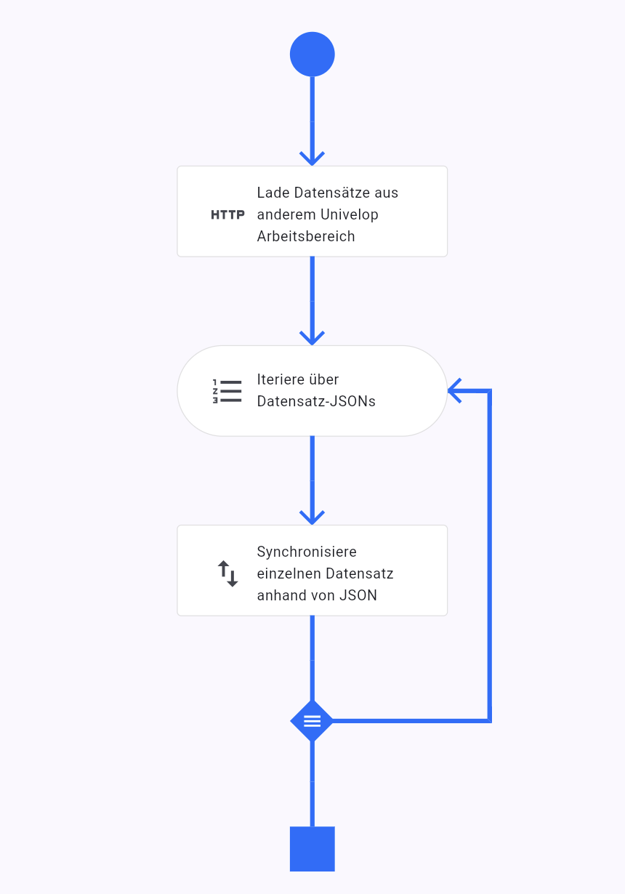

Mit dem Schritt _Synchronisiere einen Datensatz_ wird genau ein Datensatz einer Liste aus einem JSON-Objekt angelegt oder aktualisiert. Typischerweise ist das ein Datensatz, der über die [REST-API V2](/docs/interfaces/rest-api) aus einem anderen Arbeitsbereich geladen wurde. Es kann aber jedes JSON verwendet werden, dessen Schlüssel den technischen Namen der Bausteine in der Ziel-Liste entsprechen.

Die Schlüssel im JSON werden automatisch den technischen Namen der Ziel-Liste zugeordnet. Eine manuelle Zuordnung einzelner Bausteine ist nicht nötig. Die Bausteinwerte des synchronisierten Datensatzes sind in folgenden Schritten über den technischen Namen des Schritts zugreifbar, wie bei [Wähle Datensatz](/docs/workflows/record-loading/choose-record).

In den meisten Fällen sollte die Ziel-Liste einen eigenen Textfeld-Baustein für die Fremd-ID haben. Da Univelop Datensatz-IDs selbst vergibt und eine Kopie nie die ID ihres Originals tragen kann, speichert dieser Baustein die ID des Originals, damit der Schritt bei jedem weiteren Durchlauf denselben Datensatz wiederfindet (siehe [Zuordnen über Fremd-ID](#zuordnen-über-fremd-id)).

## Unterstützte Bausteine

| Wird synchronisiert | Wird nicht synchronisiert |
|---|---|
| Textfeld, Nummer, E-Mail, Telefon | Unterschrift, Zeichnung, Zeichnungsanmerkungen |
| Datum, Datumsspanne, Zeitspanne | PDF-Formular, PDF-Ausdruck |
| Abmessungen, Schalter, Farbauswahl | Editor (Rich Text) |
| Drop-Down, Mehrfach-Auswahl, Segmente, Status | Kommentare, Änderungsverlauf, Tabelle |
| Adresse, GPS Position | Buttons (z. B. Workflow-Button, Status Button) |
| Datensatz, Datensätze | Formelbausteine (berechnete Werte) |
| Laufende Nummer, Checkliste | Systemwerte (z. B. Erstellt am, Erstellt von) |
| **Datei Upload** und **Bild Upload** inklusive Dateien | |

Bei _Datei Upload_ und _Bild Upload_ werden die Dateien selbst übertragen:

- Neue und geänderte Dateien werden hochgeladen.
- Unveränderte Dateien werden am Hash erkannt und nicht erneut übertragen.
- Dateien, die im JSON nicht mehr enthalten sind, werden aus dem Baustein im Ziel-Datensatz gelöscht.

## Einstellungen

1. **Verknüpfung mit**: Die Ziel-Liste, in der der Datensatz angelegt oder aktualisiert wird.
2. **Datensatz-JSON**: Das JSON-Objekt des Datensatzes, meist eine Variable aus einem vorherigen Schritt (z. B. `params.item`). Ein JSON-Text, der ein Objekt beschreibt, wird ebenfalls akzeptiert.
3. **Zuordnen über**: Wie der bestehende Datensatz gefunden wird: _Fremd-ID_ oder _Sekundärschlüssel_. Siehe unten.
4. **Referenzen auflösen über**: _Titel_ (Standard) oder _ID_. Siehe unten.
5. **Fehler-Verhalten**: _Workflow abbrechen_ (Standard) oder _Ignorieren_. Siehe unten.

### Zuordnen über Fremd-ID

Der Datensatz wird über einen Textfeld-Baustein der Ziel-Liste gefunden, in dem die ID des Quell-Datensatzes gespeichert ist.

- **Schlüssel der Fremd-ID im JSON**: Der Schlüssel, unter dem die ID im JSON steht (Standard: `id`).
- **Baustein für die Fremd-ID**: Der Textfeld-Baustein, in dem die Fremd-ID gespeichert wird.

Die Fremd-ID wird in diesem Modus immer gespeichert. Enthält das JSON keine oder eine leere Fremd-ID, bricht der Schritt mit einem Fehler ab.

### Zuordnen über Sekundärschlüssel

Der Datensatz wird über die [Sekundärschlüssel](/docs/designmode/component/advanced) der Ziel-Liste gefunden. Die technischen Namen der Sekundärschlüssel-Bausteine müssen im JSON enthalten sein.

- Alle Schlüsselwerte müssen im JSON enthalten sein. Fehlt ein Wert oder ist er `null`, bricht der Schritt mit einem Fehler ab.
- **Fremd-ID speichern**: _Optional._ Speichert zusätzlich die Fremd-ID im gewählten Textfeld-Baustein. Enthält das JSON keine Fremd-ID, bleibt der gespeicherte Wert unverändert.
- Die Fremd-ID wird in diesem Modus nur gespeichert, nicht zum Finden des Datensatzes verwendet.

### Referenzen auflösen über

Bestimmt, wie verknüpfte Datensätze und Auswahl-Optionen zugeordnet werden.

| Option | Datensatz / Datensätze | Drop-Down, Status u. ä. |
|---|---|---|
| **Titel** | Der Titel wird aus dem Titel-Schlüssel gelesen (z. B. `kunde_title`). Verknüpft wird der Datensatz mit diesem Titel in der Ziel-Liste. | Zuordnung über das Label der Option |
| **ID** | Die IDs werden unverändert übernommen. | Zuordnung über die ID der Option |

_Titel_ eignet sich für Listen, die nicht geteilt sind. _ID_ ist hauptsächlich bei geteilten Listen sinnvoll, deren Datensätze in beiden Arbeitsbereichen dieselbe ID haben.

Gibt es mehrere Datensätze mit demselben Titel, wird der erste Treffer verknüpft, wie beim regulären Import. Wird kein Datensatz gefunden, ist das ein Fehler.

### Fehler-Verhalten

- **Workflow abbrechen**: Der Workflow wird mit einer Fehlermeldung beendet.
- **Ignorieren**: Es wird nichts gespeichert und der Schritt gibt keinen Datensatz zurück (die Variable ist leer). Der Workflow läuft weiter, der Fehler wird als Warnung im Protokoll vermerkt.

Typische Fehler sind eine fehlende Fremd-ID, ein verknüpfter Datensatz, der nicht gefunden wird, oder ein Wert, der nicht zum Baustein passt.

## Verarbeitung der Werte

- Fehlt ein Schlüssel im JSON, bleibt der Baustein unverändert. Ein explizites `null` leert den Baustein.
- Groß- und Kleinschreibung der Schlüssel wird ignoriert.
- Schlüssel ohne passenden technischen Namen werden nicht importiert und im Workflow-Protokoll als _Unbekannte Schlüssel_ aufgeführt.
- Schreibgeschützte Werte (z. B. berechnete Werte oder Titel) und Bausteine, die nicht bearbeitet werden dürfen, werden ohne Meldung übersprungen.
- Bausteine mit mehreren Werten (z. B. Adresse mit Straße und Ort, Datumsspanne mit Start und Ende) können als Ganzes oder über die einzelnen technischen Namen angegeben werden. Beide Varianten aus der API sind gleichwertig.
- Textfelder übernehmen jeden Wert als Text. Listen werden mit Komma getrennt, z. B. wird `kunden_titles` aus einem Datensätze-Baustein zu `Kunde 1, Kunde 2`. So lassen sich Titel verknüpfter Datensätze auch in einem einfachen Textfeld speichern.
- Dateien werden als Liste von Datei-Objekten angegeben, wie sie die API liefert (mit `name`, `url` und `hash`).
- Hat sich nichts geändert, wird der Datensatz nicht erneut gespeichert.

## Beispiel: Synchronisation per Web-Request

Datensätze aus einem anderen Arbeitsbereich sollen regelmäßig übernommen werden:

1. **Lade Datensätze aus anderem Univelop Arbeitsbereich**: Schritt [Sende Web-Request](/docs/workflows/advanced/web-request) mit dem technischen Namen `web_request`. Er lädt die Datensätze über die [REST-API V2](/docs/interfaces/rest-api) des Quell-Arbeitsbereichs.
2. **Iteriere über Datensatz-JSONs**: Schritt [Iteriere über Werte](/docs/workflows/structure/iterate-list) mit dem Ausdruck `parseJson(web_request.body)`.
3. **Synchronisiere einzelnen Datensatz anhand von JSON**: Schritt _Synchronisiere einen Datensatz_ innerhalb der Schleife. Als **Datensatz-JSON** wird der aktuelle Wert der Iteration verwendet, also der technische Name des Schritts aus 2.

## Credits und Protokoll

Der Schritt verbraucht **1 Credit pro Datensatz**. Hinzu kommen **20 Credits pro Megabyte** übertragener Dateien und **0,1 Credits pro gelöschter Datei**.

Im Workflow-Protokoll wird pro Datensatz vermerkt, ob er angelegt, aktualisiert (mit den geänderten Bausteinen und übertragenen Dateien) oder bereits aktuell war. Unbekannte Schlüssel werden zusätzlich aufgeführt.

## Einschränkungen

Bei der Zuordnung über _Sekundärschlüssel_ müssen alle Schlüssel in der Quelle gefüllt sein. Datensätze, deren Schlüssel erst nachträglich gefüllt werden, lassen sich bis dahin nur über die _Fremd-ID_ synchronisieren.

## Hinweise

- Verfügbar in: Server-Automatisierung.

## Verwandte Schritte

- [Sende Web-Request](/docs/workflows/advanced/web-request): Zum Laden der Datensätze aus einem anderen System
- [Ändere einen Datensatz](/docs/workflows/record-editing/modify-record): Zum gezielten Ändern einzelner Bausteinwerte
- [Erstelle einen neuen Datensatz](/docs/workflows/record-loading/create-record): Zum Anlegen von Datensätzen mit manueller Zuordnung
